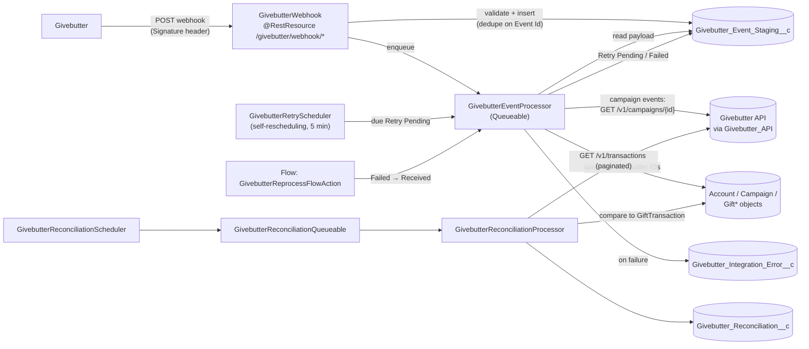

# Givebutter-integration-with-Salesforce-using-Webhook-and-API
# Givebutter ↔ Salesforce Integration

A Salesforce Apex integration that brings [Givebutter](https://givebutter.com) fundraising data into Salesforce **Nonprofit Cloud (Fundraising)** objects. It combines a **signed webhook receiver** (real-time ingestion), a **staging + retry + reprocess framework** (reliability), a **scheduled API-polling reconciliation job** (verification), and a small set of **outbound API actions** (Salesforce → Givebutter) that Flows can call.

> **Scope note.** This repository contains Apex classes only (API version 67.0). Custom objects, custom fields, Custom Metadata, the Named/External Credential, Flows, permission sets, and Sites/guest-user configuration are **not** in the repo. This README documents them as the code *requires* them, and marks anything that is a deployment decision rather than something the code defines.

---

## Table of contents

0. [How it works](#0-how-it-works)
1. [Overview and objectives](#1-overview-and-objectives)
2. [Architecture and data flow](#2-architecture-and-data-flow)
3. [Integration approaches: webhook vs. API](#3-integration-approaches-webhook-vs-api)
4. [Repository contents (Apex classes)](#4-repository-contents-apex-classes)
5. [Salesforce objects and fields used](#5-salesforce-objects-and-fields-used)
6. [Field mappings](#6-field-mappings)
7. [Authentication and Named Credentials](#7-authentication-and-named-credentials)
8. [Installation, configuration and deployment](#8-installation-configuration-and-deployment)
9. [Scheduling and synchronization](#9-scheduling-and-synchronization)
10. [Error handling, staging, retries and reprocessing](#10-error-handling-staging-retries-and-reprocessing)
11. [Transaction reconciliation](#11-transaction-reconciliation)
12. [Testing and example workflows](#12-testing-and-example-workflows)
13. [Security considerations](#13-security-considerations)
14. [Known limitations and recommended improvements](#14-known-limitations-and-recommended-improvements)

---

## 0. How it works

*(Start here if you are not a developer. The technical sections follow.)*

**The problem this solves.** A nonprofit collects donations through Givebutter (online giving pages, recurring plans, refunds). The finance and fundraising teams work in Salesforce. Without this integration, someone would have to retype every donor and donation by hand. This project does that automatically and checks the result.

**Think of it as a mail room:**

| Real-world role | What it is in this project |
|---|---|
| A courier arrives with a sealed package | Givebutter sends a **webhook** (an automatic message: "a donation just happened") |
| The front desk checks the courier's ID | The code checks the **signing secret** so only Givebutter is accepted |
| The package is logged in a ledger before anyone opens it | The message is saved as a **staging record** (`Givebutter_Event_Staging__c`) |
| A clerk opens the package and files the contents | A background job (**`GivebutterEventProcessor`**) creates the donor, gift, campaign, etc. in Salesforce |
| If the clerk hits a temporary problem, they try again later | **Automatic retries** (after 5, 15, 60, then 240 minutes) |
| If the paperwork is wrong, it is set aside for a human to fix | Status **Failed**; an admin fixes the cause and clicks **Reprocess** |
| At the end of the day, the accountant counts both ledgers | **Reconciliation** compares Givebutter's transactions with Salesforce's |

**What happens when someone donates (step by step):**

1. A donor gives $50 on a Givebutter page.
2. Givebutter immediately sends Salesforce a message describing the donor and the donation.
3. Salesforce checks the message is genuinely from Givebutter, saves a copy, and replies "got it" within moments.
4. In the background, Salesforce finds or creates the **donor** (a Person Account), then creates the **Gift Transaction** for $50, linked to the donor, the campaign and the fund.
5. If anything goes wrong, the copy of the message is kept, the reason is recorded, and the system either retries automatically or waits for an admin.
6. Later, the reconciliation job asks Givebutter "what transactions happened on this date?" and confirms every one is in Salesforce with the same amount.

**Two safety nets** protect against lost or duplicated data: every message has a unique ID so it is never processed twice, and every record is matched on its Givebutter ID so re-running never creates a second copy of a donor or gift.

**What it does *not* do:** it does not delete anything, does not fix mismatches by itself, and only creates the Campaign and Fund in Givebutter when a Flow tells it to.

### Glossary

| Term | Meaning |
|---|---|
| **Webhook** | An automatic message one system sends another when something happens ("push" instead of asking repeatedly) |
| **API** | A way for one system to ask another for data or ask it to do something |
| **Polling** | Asking an API for data on a schedule (used here for reconciliation) |
| **Named Credential** | Salesforce's safe place to store how to log in to an outside service, so no password is in the code |
| **Custom Metadata** | Admin-managed settings stored in Salesforce (used here for the signing secret) |
| **Apex** | Salesforce's programming language |
| **Queueable** | An Apex job that runs in the background, after the main request has finished |
| **Schedulable** | An Apex job that runs at a set time |
| **Staging record** | A saved copy of an incoming message, kept before it is processed |
| **Idempotent** | Safe to run twice: the second run changes nothing |
| **Person Account** | Salesforce's record type for an individual person (a donor) |
| **Gift Transaction** | One donation payment |
| **Gift Commitment** | A recurring-giving promise (a Givebutter "plan") |
| **Gift Designation** | Where a gift is directed (a Givebutter "fund") |
| **Reconciliation** | Comparing two sets of records to confirm they agree |
| **Flow** | Salesforce's no-code automation tool |

---

## 1. Overview and objectives

**Objectives (as implemented in code):**

- Receive Givebutter webhook events and **acknowledge them quickly**, storing the raw payload before any business logic runs.
- Create or update the corresponding Salesforce records **idempotently**, keyed on Givebutter IDs.
- **Retry** transient failures automatically with backoff, and let an administrator **fix and reprocess** permanent failures.
- **Reconcile** Givebutter transactions against Salesforce Gift Transactions on a date range and record the result.
- Optionally push **Campaigns** and **Funds** from Salesforce to Givebutter through Flow-invocable actions.

**Supported inbound webhook events**

| Event | Result in Salesforce |
|---|---|
| `contact.created` | Person Account created, or the linked one updated |
| `transaction.succeeded` | Gift Transaction (+ Gift Designation and Gift Transaction Designation when a fund is present) |
| `campaign.created`, `campaign.updated` | Campaign, and Gift Designation + Gift Default Designation when the campaign has a default fund |
| `plan.created`, `plan.updated`, `plan.canceled`, `plan.paused`, `plan.resumed`, `plan.failed` | Gift Commitment + Gift Commitment Schedule |
| `refund.created` | Gift Refund linked to the Gift Transaction |

Any other event type is staged and then marked **Failed** with the message `Event type is not handled: <type>`.

---

## 2. Architecture and data flow



**Inbound request lifecycle (`GivebutterWebhook.receiveWebhook`)**

1. Read the body → `400` if empty.
2. Read the `Signature` header → `401` if missing.
3. Validate the signature against the configured secret → `401` if invalid.
4. Parse JSON → `400` if invalid; require `event` and `id` → `400` if missing.
5. Look up an existing staging record by `Givebutter_Event_Id__c`; if found, return `200` ("Event already received") so Givebutter stops retrying.
6. Insert a `Givebutter_Event_Staging__c` (`Status__c = 'Received'`, `Retry_Count__c = 0`). A unique-key collision from a simultaneous duplicate delivery is also answered with `200`.
7. Enqueue `GivebutterEventProcessor` and return `200`. Any unexpected staging failure returns `500`, so Givebutter can redeliver.

**Asynchronous processing (`GivebutterEventProcessor`, a `Queueable` with callouts)**

1. Load the staging record and parse the stored payload.
2. For `campaign.created` / `campaign.updated`, call `GET /v1/campaigns/{id}`, merge the fresh data over the webhook data, and extract the default fund.
3. Set `Status__c = 'Processing'`, route the event, and on success set `Processed` with `Salesforce_Record_Id__c`.
4. On exception, classify the error, schedule a retry or mark `Failed`, and write a `Givebutter_Integration_Error__c` row.

Callouts are made *before* the first DML in the transaction, which Salesforce requires.

---

## 3. Integration approaches: webhook vs. API

The integration uses both, for different purposes.

| | Webhook (push) | API polling / calls |
|---|---|---|
| **Direction** | Givebutter → Salesforce | Salesforce → Givebutter |
| **Purpose** | Real-time creation/update of Salesforce records | Reconcile totals, enrich campaign data, recover contacts, create Campaigns/Funds |
| **Entry point** | `GivebutterWebhook` (REST) | `GivebutterReconciliationQueueable`, `GivebutterEventProcessor`, `GivebutterCampaignApiService`, `GivebutterFundApiService` |
| **Auth** | `Signature` header compared to a stored secret | Named Credential `Givebutter_API` |
| **Triggered by** | Givebutter events | Schedule, event processing, manual reprocess, or Flow |

Givebutter API endpoints used by the code (all through `callout:Givebutter_API`):

| Method & path | Used by | Purpose |
|---|---|---|
| `GET /v1/transactions?transactedAfter=…&transactedBefore=…` | `GivebutterTransactionService` | Paginated transaction list for reconciliation (follows `links.next`) |
| `GET /v1/campaigns/{id}` | `GivebutterEventProcessor` | Fresh campaign data for `campaign.*` events |
| `GET /v1/contacts/{id}` | `GivebutterEventProcessor` | Fresh contact data on manual reprocess of `contact.created` |
| `POST /v1/campaigns` | `GivebutterCampaignApiService` | Create a Givebutter campaign from a Salesforce Campaign |
| `POST /v1/funds` | `GivebutterFundApiService` | Create a Givebutter fund from a Gift Default Designation |
| `GET /v1/campaigns/{id}` | `GivebutterCampaignApiTest` | Manual connectivity check (debug-log utility) |

---

## 4. Repository contents (Apex classes)

All classes are flat in the repository root, each with a `.cls-meta.xml` (API 67.0, Active).

### Core pipeline

| Class | Sharing | Responsibility |
|---|---|---|
| `GivebutterWebhook` | `without sharing` | `@RestResource(urlMapping='/givebutter/webhook/*')`. Validates, de-duplicates and stages events. Contains the `GivebutterEventProcessor` queueable, event router, retry classification, error logging, and the business logic for contacts, transactions, campaigns, plans, schedules and refunds (see the note below). |
| `GivebutterRetryScheduler` | `without sharing` | `Schedulable`. Every run picks one due `Retry Pending` staging record, marks it `Processing`, enqueues the processor, and **reschedules itself 5 minutes later**. |
| `GivebutterReprocessFlowAction` | `with sharing` | `@InvocableMethod` "Reprocess Givebutter Event". Resets `Failed` staging records and re-enqueues them (max 50 per call). |

### Reconciliation

| Class | Responsibility |
|---|---|
| `GivebutterReconciliationScheduler` | `Schedulable`; enqueues `GivebutterReconciliationQueueable` (today's date range). |
| `GivebutterReconciliationQueueable` | `Queueable` + callouts; default range is today → today, or a custom `(fromDate, toDate)` constructor. |
| `GivebutterReconciliationProcessor` | Compares Givebutter and Salesforce transactions, writes the `Givebutter_Reconciliation__c` summary and per-record status. |
| `GivebutterTransactionService` | Paginated `GET /v1/transactions` for a date range. |
| `GivebutterReconciliationService` | Single-page `GET /v1/transactions` helper that returns the raw body. **Not referenced by any other class.** |

### Outbound (Salesforce → Givebutter)

| Class | Responsibility |
|---|---|
| `GivebutterCampaignApiService` | `@InvocableMethod` "Create Givebutter Campaign". Queueable posts `{type: "fundraise", title, description}` to `/v1/campaigns`; on `201`, writes the returned ID to `Campaign.Givebutter_Campaign_ID__c`. Skips campaigns that already have an ID. |
| `GivebutterFundApiService` | `@InvocableMethod` "Create Givebutter Fund" (input: a `GiftDefaultDesignation` Id). Requires the parent record to be a Campaign that already has a Givebutter Campaign ID, then posts `{name, code?}` to `/v1/funds` and saves the returned ID to `GiftDesignation.Givebutter_Fund_ID__c`. Skips if the designation already has a fund ID. |

### Settings and security helpers

| Class | Responsibility |
|---|---|
| `GivebutterSettingsService` | Reads Custom Metadata `Givebutter_Settings__mdt` record **`Default`** and returns `Signing_Secret__c`. Throws if the record or secret is missing. |
| `GivebutterSignatureService` | Compares the received `Signature` header to the configured secret. |

### Standalone domain services

`GivebutterCampaignService`, `GivebutterPersonAccountService`, `GivebutterGiftDesignationService`, `GivebutterGiftTransactionService`, `GivebutterGiftCommitmentService`, `GivebutterGiftCommitmentScheduleService`, `GivebutterGiftRefundService`.

> **Important: duplicated logic.** `GivebutterWebhook` does **not** call these classes. It contains its own `private static` copies of the settings, signature, campaign, person-account, designation, transaction, commitment, schedule and refund logic, and the event processor uses those copies. A search of the repository shows the only cross-references among the standalone classes are: `GivebutterSignatureService → GivebutterSettingsService`, `GivebutterReconciliationProcessor → GivebutterTransactionService`, `GivebutterGiftTransactionService → GivebutterGiftDesignationService / GivebutterPersonAccountService`, and `GivebutterGiftCommitmentService → GivebutterPersonAccountService`. The standalone and inline versions can behave differently; for example, the standalone `GivebutterPersonAccountService` is documented in its header as relying on a Salesforce Matching/Duplicate Rule, whereas the inline version in `GivebutterWebhook` explicitly blocks email conflicts (see [§6.1](#61-contact--person-account)). **Treat `GivebutterWebhook` as the behavior of record** and confirm any standalone class against it before relying on it.

### Utility

| Class | Notes |
|---|---|
| `GivebutterCampaignApiTest` | Despite the name, **not a unit test** (no `@isTest`). Two static methods, `testCampaign(id)` and `inspectCampaignFields(id)`, make a live `GET /v1/campaigns/{id}` and print the result to the debug log. Run from Anonymous Apex to verify the credential. |

---

## 5. Salesforce objects and fields used

This section lists **every object and field the code touches**. "Type" is inferred from how the code uses the field (the repo does not contain the field definitions), so match it when you create them. **R** = the code reads it, **W** = the code writes it.

**Prerequisites:** Nonprofit Cloud / Fundraising, **Person Accounts**, and **multi-currency** (the code sets `CurrencyIsoCode`).

### 5.1 Objects at a glance

| Object | Standard / Custom | Role in the integration |
|---|---|---|
| `Givebutter_Event_Staging__c` | Custom | Inbox of webhook messages and their processing state |
| `Givebutter_Integration_Error__c` | Custom | Log of each failed processing attempt |
| `Givebutter_Reconciliation__c` | Custom | Summary of each reconciliation run |
| `Givebutter_Settings__mdt` | Custom Metadata | Holds the webhook signing secret |
| `Account` (Person Account) | Standard | The donor |
| `Campaign` | Standard | A Givebutter campaign |
| `GiftTransaction` | Standard (Fundraising) | One donation |
| `GiftTransactionDesignation` | Standard (Fundraising) | How a donation is split across funds |
| `GiftDesignation` | Standard (Fundraising) | A Givebutter fund |
| `GiftDefaultDesignation` | Standard (Fundraising) | A campaign's default fund |
| `GiftCommitment` | Standard (Fundraising) | A recurring plan |
| `GiftCommitmentSchedule` | Standard (Fundraising) | The plan's billing schedule (written through the standard action `manageRcrGiftCmtSchd`) |
| `GiftRefund` | Standard (Fundraising) | A refund against a donation |
| `RecordType` | Standard | Read once to find the Person Account record type |

### 5.2 Custom objects: all fields

**`Givebutter_Event_Staging__c`** (the inbox)

| Field | Type (inferred) | Plain meaning | Used by |
|---|---|---|---|
| `Givebutter_Event_Id__c` | Text, **Unique** | Givebutter's ID for the message; prevents double-processing | W/R: Webhook |
| `Event_Type__c` | Text | What happened, e.g. `transaction.succeeded` | W: Webhook; R: Reprocess |
| `Payload__c` | Long text | The complete original message (JSON) | W/R: Webhook |
| `Status__c` | Picklist/Text | `Received`, `Processing`, `Processed`, `Retry Pending`, `Failed` | W/R: Webhook, RetryScheduler, Reprocess |
| `Received_At__c` | DateTime | When Salesforce got it | W: Webhook |
| `Processing_Started__c` | DateTime | When processing began | W: Webhook |
| `Processed_At__c` | DateTime | When it finished successfully | W: Webhook |
| `Givebutter_Record_Id__c` | Text | The Givebutter ID of the thing in the message (contact, campaign, etc.) | W: Webhook; R: Reprocess |
| `Salesforce_Record_Id__c` | Text/ID | The main Salesforce record created or updated | W: Webhook |
| `Retry_Count__c` | Number | How many retries so far | W/R: Webhook, RetryScheduler |
| `Next_Retry_At__c` | DateTime | When the next automatic retry is due | W/R: Webhook, RetryScheduler, Reprocess |
| `Retry_Reason__c` | Text | Why a retry was scheduled | W: Webhook |
| `Error_Message__c` | Text/Long text | Latest error message | W: Webhook |
| `Error_Category__c` | Picklist | `Transient` (try again) or `Permanent` (needs a human) | W: Webhook |
| `Reprocess_Requested__c` | Checkbox | Admin ticks this to allow a reprocess | R/W: Reprocess |

**`Givebutter_Integration_Error__c`** (the error log)

| Field | Type (inferred) | Plain meaning | Used by |
|---|---|---|---|
| `Givebutter_Event__c` | Lookup → Staging | Which event failed | W: Webhook |
| `Error_Type__c` | Picklist | `Authentication`, `Configuration`, `Salesforce DML`, `Unknown` | W: Webhook |
| `Error_Message__c` | Text/Long text | What went wrong | W: Webhook |
| `Stack_Trace__c` | Long text | Technical trace for developers | W: Webhook |
| `Retry_Number__c` | Number | Which attempt this was | W: Webhook |

**`Givebutter_Reconciliation__c`** (reconciliation run summary)

| Field | Type (inferred) | Plain meaning | Used by |
|---|---|---|---|
| `Run_Date__c` | DateTime | When the run happened | W: ReconciliationProcessor |
| `From_Date__c`, `To_Date__c` | Date | Date range checked | W: ReconciliationProcessor |
| `Givebutter_Count__c`, `Givebutter_Total__c` | Number / Currency | Number and total amount of transactions in Givebutter | W: ReconciliationProcessor |
| `Salesforce_Count__c`, `Salesforce_Total__c` | Number / Currency | Same, for Salesforce | W: ReconciliationProcessor |
| `Matched_Count__c` | Number | Transactions that agree | W: ReconciliationProcessor |
| `Mismatch_Count__c` | Number | Same ID, different amount | W: ReconciliationProcessor |
| `Missing_Count__c` | Number | In Givebutter, not in Salesforce | W: ReconciliationProcessor |
| `Corrected_Count__c`, `Error_Count__c` | Number | Always written as 0 today (reserved) | W: ReconciliationProcessor |
| `Status__c` | Picklist | `Completed` or `Completed with Errors` | W: ReconciliationProcessor |
| `Error_Details__c` | Long text | Lists the missing and mismatched IDs | W: ReconciliationProcessor |

**`Givebutter_Settings__mdt`** (Custom Metadata): record name `Default`, field `Signing_Secret__c` (Text). Read by `GivebutterSettingsService` and `GivebutterWebhook`.

### 5.3 Custom fields added to standard objects

| Object | Field | Type (inferred) | Plain meaning | Used by |
|---|---|---|---|---|
| `Account` | `Givebutter_Contact_ID__c` | Text | The donor's ID in Givebutter (the link between the two systems) | R/W: Webhook |
| `Campaign` | `Givebutter_Campaign_ID__c` | Text | Campaign ID in Givebutter | R/W: Webhook, CampaignApiService; R: FundApiService |
| `Campaign` | `Givebutter_Campaign_Code__c` | Text | Campaign code | W: Webhook |
| `GiftDesignation` | `Givebutter_Fund_ID__c` | Text | Fund ID in Givebutter | R/W: Webhook, FundApiService |
| `GiftDesignation` | `Givebutter_Fund_Code__c` | Text | Fund code | R/W: Webhook; R: FundApiService |
| `GiftDesignation` | `Givebutter_Fund_Name__c` | Text | Fund name | R/W: Webhook; R: FundApiService |
| `GiftTransaction` | `Givebutter_Transaction_ID__c` | Text | Transaction ID in Givebutter | R/W: Webhook; R: ReconciliationProcessor, refund logic |
| `GiftTransaction` | `Givebutter_Transaction_Number__c` | Text | Human-friendly transaction number | W: Webhook |
| `GiftTransaction` | `Givebutter_Donated_Amount__c` | Currency | Amount actually donated (excludes covered fees); used for reconciliation | W: Webhook; R: ReconciliationProcessor |
| `GiftTransaction` | `Givebutter_Payout_Amount__c` | Currency | Amount paid out to the nonprofit | W: Webhook |
| `GiftTransaction` | `Givebutter_Fair_Market_Value__c` | Currency | Fair market value of any benefit given to the donor | W: Webhook |
| `GiftTransaction` | `Reconciliation_Status__c` | Picklist | `Matched` or `Mismatch` | W: ReconciliationProcessor |
| `GiftTransaction` | `Last_Reconciliation_Date__c` | Date | Last date it was checked | W: ReconciliationProcessor |
| `GiftTransaction` | `Givebutter_Reconciliation__c` | Lookup → Reconciliation | The run that flagged this as a mismatch | W: ReconciliationProcessor |
| `GiftCommitment` | `Givebutter_Plan_ID__c` | Text | Recurring plan ID in Givebutter | R/W: Webhook |
| `GiftCommitmentSchedule` | `Givebutter_Plan_ID__c` | Text | Plan ID, passed to the standard action | W: Webhook |
| `GiftRefund` | `Givebutter_Refund_ID__c` | Text | Refund ID in Givebutter | R/W: Webhook |
| `GiftRefund` | `Givebutter_Transaction_ID__c` | Text | Which Givebutter transaction was refunded | W: Webhook |
| `GiftRefund` | `Givebutter_Refund_Amount__c` | Currency | Refund amount as reported by Givebutter | W: Webhook |

### 5.4 Standard fields used

| Object | Fields the code sets or reads |
|---|---|
| `Account` | `RecordTypeId`, `IsPersonAccount`, `FirstName`, `LastName`, `PersonEmail`, `PersonMobilePhone` |
| `Campaign` | `Name`, `Description` |
| `GiftTransaction` | `Name`, `DonorId`, `OriginalAmount`, `PaymentMethod`, `PaymentIdentifier`, `ProcessorReference`, `TransactionDate`, `Status`, `CurrencyIsoCode`, `ProcessorTransactionFee`, `DonorCoverAmount`, `CampaignId`, `Description`; read-only: `IsPartiallyRefunded`, `RefundedAmount` |
| `GiftTransactionDesignation` | `GiftTransactionId`, `GiftDesignationId`, `Amount`, `Percent` |
| `GiftDesignation` | `Name`, `IsActive` (also reads `Description`) |
| `GiftDefaultDesignation` | `ParentRecordId`, `GiftDesignationId`, `AllocatedPercentage` |
| `GiftCommitment` | `Name`, `DonorId`, `NextTransactionAmount`, `NextTransactionDate`, `EffectiveStartDate`, `RecurrenceType`, `Status`, `CurrencyIsoCode`, `Description` |
| `GiftCommitmentSchedule` (via action input) | `GiftCommitmentId`, `StartDate`, `TransactionAmount`, `TransactionInterval`, `TransactionPeriod`, `TransactionDay`, `PaymentMethod`, `EndDate` |
| `GiftRefund` | `GiftTransactionId`, `Amount`, `Date`, `Reason`, `Status` |

### 5.5 Which object each event touches

| Event | Objects written |
|---|---|
| `contact.created` | Account |
| `transaction.succeeded` | Account (if donor is new), GiftTransaction, GiftDesignation, GiftTransactionDesignation |
| `campaign.created` / `campaign.updated` | Campaign, GiftDesignation, GiftDefaultDesignation |
| `plan.*` | Account (if donor is new), GiftCommitment, GiftCommitmentSchedule |
| `refund.created` | GiftRefund |
| *every event* | Givebutter_Event_Staging__c (always); Givebutter_Integration_Error__c (on failure) |
| Reconciliation run | Givebutter_Reconciliation__c, GiftTransaction (status fields) |

---

## 6. Field mappings

All inbound writes use `Database.insert/update(..., AccessLevel.SYSTEM_MODE)` and are keyed on the Givebutter ID so reprocessing does not create duplicates.

### 6.1 Contact → Person Account

| Givebutter (`data`) | Salesforce |
|---|---|
| `id` | `Account.Givebutter_Contact_ID__c` |
| `first_name` | `FirstName` (default `Givebutter` if blank, on insert) |
| `last_name` | `LastName` (default `Donor` if blank, on insert) |
| `primary_email`, else first `emails[].value` | `PersonEmail` (trimmed, lower-cased) |
| `primary_phone`, else first `phones[].value` | `PersonMobilePhone` |

Matching rules in `GivebutterWebhook`:

1. Email is **required**; otherwise the event fails with an actionable message.
2. If an Account already has this `Givebutter_Contact_ID__c`: it must be a Person Account, its email must not belong to a *different* Person Account, and then it is updated.
3. Otherwise, if **any** Person Account already has that email, the event **fails** ("Duplicate email blocked"). Nothing is inserted or updated. Fix the email in Givebutter and reprocess.
4. Otherwise a new Person Account is inserted (duplicate rules enforced; a duplicate-rule block also fails the event).

The same logic is used when a transaction or plan arrives for a donor.

### 6.2 Transaction → Gift Transaction

| Givebutter | Salesforce `GiftTransaction` |
|---|---|
| `id` | `Givebutter_Transaction_ID__c`, `PaymentIdentifier`, `ProcessorReference` |
| `number` | `Givebutter_Transaction_Number__c` |
| `amount` | `OriginalAmount` |
| `donated` | `Givebutter_Donated_Amount__c` |
| `payout` | `Givebutter_Payout_Amount__c` |
| `fee` | `ProcessorTransactionFee` |
| `fee_covered` | `DonorCoverAmount` |
| `fair_market_value_amount` | `Givebutter_Fair_Market_Value__c` |
| `payment_method` (fallback `method`) | `PaymentMethod` |
| `status` | `Status` |
| `currency` | `CurrencyIsoCode` |
| `transacted_at` | `TransactionDate` (date part; today if absent) |
| `campaign_id` | `CampaignId` via `Campaign.Givebutter_Campaign_ID__c` (ignored if blank, `0`, or no match) |
| `campaign_title` | `Description` |
| donor (`contact_id`, names, `email`, `phone`) | `DonorId` (Person Account, see §6.1) |
| – | `Name` = `"<First Last> - <amount> - <date>"` |
| `fund_id` (+ `fund_name`, `fund_code`) | `GiftDesignation` (find/create by `Givebutter_Fund_ID__c`) and `GiftTransactionDesignation` (`Amount` = `amount`, `Percent` = 100) |

If the transaction already exists, the Gift Transaction fields are **not** modified; only the designation records are ensured when `fund_id` is present.

### 6.3 Campaign → Campaign, Gift Designation, Gift Default Designation

| Givebutter | Salesforce |
|---|---|
| `id` | `Campaign.Givebutter_Campaign_ID__c` |
| `title` | `Campaign.Name` (fallback `Givebutter Campaign <id>`) |
| `code` | `Campaign.Givebutter_Campaign_Code__c` |
| `description` | `Campaign.Description` |
| default fund (from `default_fund*` keys, nested objects, or `settings[]` entry named `default_fund`) | `GiftDesignation.Givebutter_Fund_ID__c`, then a `GiftDefaultDesignation` (`ParentRecordId` = Campaign, `AllocatedPercentage` = 100) |

A campaign with no default fund is still saved and the event succeeds; the designation link is created by a later `campaign.updated` once a fund exists. Duplicate `GiftDefaultDesignation` rows for the same campaign are deleted.

### 6.4 Plan → Gift Commitment and Schedule

| Givebutter | Salesforce |
|---|---|
| `id` | `GiftCommitment.Givebutter_Plan_ID__c` |
| donor fields | `GiftCommitment.DonorId` |
| `amount` | `NextTransactionAmount` |
| `next_bill_date` | `NextTransactionDate` |
| `start_at` | `EffectiveStartDate` |
| `frequency` | `RecurrenceType` (matched to an active picklist value by value/label) |
| `status` | `Status` (matched to an active picklist value) |
| `currency` | `CurrencyIsoCode` |
| `frequency` + `method` | `Description` |
| – | `Name` = `"<donor> - Givebutter Recurring Plan - <id>"` |

Schedule (via standard action `manageRcrGiftCmtSchd`): `StartDate` ← `start_at` (**required**), `TransactionAmount` ← `amount`, `EndDate` ← `canceled_at`, `TransactionDay` ← day of `next_bill_date` (else `start_at`), `PaymentMethod` ← matched `method`, `Givebutter_Plan_ID__c` ← plan ID. Frequency mapping: `monthly` → interval 1 / Monthly; `quarterly` → interval 3 / Monthly; `yearly`/`annual`/`annually` → interval 1 / Yearly; anything else is matched against the `TransactionPeriod` picklist with interval 1.

### 6.5 Refund → Gift Refund

| Givebutter | Salesforce `GiftRefund` |
|---|---|
| `id` | `Givebutter_Refund_ID__c` |
| `transaction_id` | `Givebutter_Transaction_ID__c` and `GiftTransactionId` (found via `GiftTransaction.Givebutter_Transaction_ID__c`; fails if not found) |
| `amount` | `Amount`, `Givebutter_Refund_Amount__c` |
| `created_at` | `Date` |
| `reason`, `status` | `Reason`, `Status` (set only if they match an active picklist value) |

---

## 7. Authentication and Named Credentials

There are two independent mechanisms. **No credential values appear in this repository, and none should be committed.**

### 7.1 Outbound API calls: Named Credential `Givebutter_API`

Every callout uses `callout:Givebutter_API/...` and **does not set an `Authorization` header in code**, so the Named Credential must supply it. The code comments describe a base URL of `https://api.givebutter.com` with Bearer-token authentication through an External Credential.

Setup outline (Setup → Security → Named Credentials):

1. Create an **External Credential** with a Custom authentication protocol and a Principal.
2. Add an authentication parameter holding your Givebutter API key (entered in Salesforce, never in source control) and a **custom header** that sends it as `Authorization: Bearer <key>`.
3. Create a **Named Credential** with the label/name **`Givebutter_API`**, URL `https://api.givebutter.com`, linked to the External Credential. The name must match exactly.
4. Create or edit a **Permission Set** granting **External Credential Principal Access** and assign it to every user who runs the integration code: the user who schedules the jobs, the Flow running users, and any user whose actions enqueue the callout jobs.

Quick check from Anonymous Apex (replace the placeholder with a real campaign ID):

```apex
GivebutterCampaignApiTest.testCampaign('<GIVEBUTTER_CAMPAIGN_ID>');
// Then read the debug log: HTTP status 200 means the credential works.
```

### 7.2 Inbound webhooks: signing secret

- Custom Metadata type `Givebutter_Settings__mdt`, record **`Default`**, field **`Signing_Secret__c`**.
- Givebutter sends the secret in a request header named **`Signature`**. The code reads `request.headers.get('Signature')` and compares it for **exact string equality** to `Signing_Secret__c`.
- The code does **not** compute an HMAC over the body. Confirm against Givebutter's current webhook documentation that this matches what your account sends.
- Missing or non-matching signature → HTTP `401`. A missing/blank configured secret is treated as a configuration error and also results in `401`.

### 7.3 Exposing the endpoint

The REST resource is `@RestResource(urlMapping='/givebutter/webhook/*')`, so the path is `/services/apexrest/givebutter/webhook/` on whichever Salesforce domain you expose it from. **How you expose it is not defined in this repo.** Givebutter cannot send a Salesforce session token, so a typical approach is a Salesforce **Site** whose guest user profile is granted access to the `GivebutterWebhook` Apex class. The signature check is then the only gate; see [§13](#13-security-considerations).

---

## 8. Installation, configuration and deployment

### Prerequisites

- Salesforce org with **Nonprofit Cloud / Fundraising** objects (Gift Transaction, Gift Commitment, Gift Designation, Gift Default Designation, Gift Refund), **Person Accounts**, and **multi-currency** enabled.
- [Salesforce CLI (`sf`)](https://developer.salesforce.com/tools/salesforcecli) authenticated to the target org.
- A Givebutter account with API access and webhook configuration permissions.

### Steps

1. **Create the metadata the code depends on** (not included in this repo): the custom objects and fields in [§5](#5-salesforce-objects-and-fields-used). Mark `Givebutter_Event_Staging__c.Givebutter_Event_Id__c` as **Unique**. Make sure `Status__c` and `Error_Category__c` picklists contain the values listed in §5 and §10.
2. **Create the Custom Metadata** type `Givebutter_Settings__mdt` with a text field `Signing_Secret__c`, then create a record named `Default`. Enter the signing secret **in Setup**, not in a file you commit.
3. **Configure authentication**: the External Credential, Named Credential `Givebutter_API`, and permission set from [§7.1](#71-outbound-api-calls-named-credential-givebutter_api).
4. **Deploy the Apex.** The repo is a flat folder of classes. Place them in a standard SFDX project and deploy:

   ```bash
   # inside an SFDX project (sfdx-project.json present)
   mkdir -p force-app/main/default/classes
   cp /path/to/this/repo/*.cls /path/to/this/repo/*.cls-meta.xml force-app/main/default/classes/
   sf project deploy start --source-dir force-app/main/default/classes --target-org <ORG_ALIAS>
   ```

   > Deploying to **production** requires 75% Apex test coverage and this repository has no unit tests (see [§12](#12-testing-and-example-workflows) and [§14](#14-known-limitations-and-recommended-improvements)). Sandbox and scratch-org deployments are not blocked by this.

5. **Expose the webhook** endpoint ([§7.3](#73-exposing-the-endpoint)) and grant the guest/site user access to the `GivebutterWebhook` class, plus the permissions the class needs on the staging object.
6. **Register the webhook in Givebutter**, pointing at `https://<your-site-domain>/services/apexrest/givebutter/webhook/`, subscribe to the events in [§1](#1-overview-and-objectives), and set the signing secret to match `Signing_Secret__c`.
7. **Start the schedulers** ([§9](#9-scheduling-and-synchronization)).
8. **Build the reprocess Flow** (optional but recommended, [§10.4](#104-manual-reprocessing)).
9. Optionally build Flows that call **Create Givebutter Campaign** and **Create Givebutter Fund**.

---

## 9. Scheduling and synchronization

Nothing in the code starts a schedule automatically. Start each one once from Anonymous Apex.

### 9.1 Retry scheduler (required for automatic retries)

`GivebutterRetryScheduler` is **self-rescheduling**: each execution looks for due records, then schedules a new one-time job 5 minutes later. Bootstrap it once with a one-time job a minute from now:

```apex
Datetime next = System.now().addMinutes(1);
String cron = next.second() + ' ' + next.minute() + ' ' + next.hour() + ' '
            + next.day() + ' ' + next.month() + ' ? ' + next.year();
System.schedule('Givebutter Retry Scheduler Bootstrap', cron, new GivebutterRetryScheduler());
```

Per run it processes **at most one** `Retry Pending` record whose `Next_Retry_At__c <= now` (`LIMIT 1 ... FOR UPDATE`). Do not start more than one chain, or you will have parallel chains. If a run fails before it reschedules, the chain stops and must be restarted (check **Setup → Scheduled Jobs** for entries named `Givebutter Retry Scheduler <timestamp>`).

### 9.2 Reconciliation

Daily run covering *today's* date:

```apex
System.schedule(
    'Givebutter Reconciliation Daily',
    '0 0 23 * * ?',                         // every day at 23:00 (org user time zone)
    new GivebutterReconciliationScheduler()
);
```

On-demand run for a specific range:

```apex
System.enqueueJob(new GivebutterReconciliationQueueable(
    Date.newInstance(2026, 10, 1),
    Date.newInstance(2026, 10, 7)
));
```

### 9.3 What synchronizes how

| Data | Mechanism | Timing |
|---|---|---|
| Contacts, transactions, campaigns, plans, refunds | Webhook → staging → queueable | Near real-time |
| Failed transient events | `GivebutterRetryScheduler` | Backoff 5 / 15 / 60 / 240 min |
| Failed permanent events | Admin fix + reprocess Flow | Manual |
| Transaction totals verification | Reconciliation job | Scheduled / on-demand |
| Salesforce Campaign / Fund → Givebutter | Flow-invoked actions | On demand |

---

## 10. Error handling, staging, retries and reprocessing

### 10.1 Staging first

The endpoint only validates, de-duplicates and stores the event, then returns `200`. Business logic runs later, so a processing problem never causes the webhook itself to fail, and the raw payload is always kept in `Payload__c`.

### 10.2 Status lifecycle

```
Received ─► Processing ─► Processed
                │
                ├─► Retry Pending ─► (scheduler) ─► Processing ─► …
                │
                └─► Failed ─► (admin fixes cause, checks Reprocess Requested, Flow runs) ─► Received ─► …
```

### 10.3 Retry policy

On any exception in the processor:

- `Retry_Count__c` is incremented; `Error_Message__c` / `Retry_Reason__c` store `<ExceptionType>: <message>` (truncated to the field length).
- The error is classified **Transient** if the lower-cased message contains `timeout`, `timed out`, `429`, `500`, `502`, `503`, or `504`; otherwise **Permanent**.
- Transient **and** retry count ≤ 4 → `Status__c = 'Retry Pending'` and `Next_Retry_At__c` is set:

  | Retry # | Delay |
  |---|---|
  | 1 | 5 minutes |
  | 2 | 15 minutes |
  | 3 | 60 minutes |
  | 4 | 240 minutes |

- Otherwise (permanent, or the fifth failure) → `Status__c = 'Failed'`, `Next_Retry_At__c = null`.
- A `Givebutter_Integration_Error__c` row is created for every failed attempt, with type, message, stack trace, and retry number. Failure to write the error row or the staging update is caught and logged, so one failure does not mask another.

Retries re-run from the **stored payload** (they do not re-fetch the contact).

### 10.4 Manual reprocessing

`GivebutterReprocessFlowAction` (Flow action **Reprocess Givebutter Event**, input `Staging Record ID`) is built to be called from a Flow that you create (the Flow is not in this repo; for example a record-triggered or screen Flow on the staging record).

Validation (all records are checked before any are changed):

- At most **50** records per call.
- Every record must exist, have `Status__c = 'Failed'`, and have `Reprocess_Requested__c = true`.
- `contact.created` records must have a `Givebutter_Record_Id__c`.

Then each record is reset to `Received` (`Reprocess_Requested__c = false`, `Next_Retry_At__c = null`) and a processor is enqueued. For **`contact.created`**, the processor first calls `GET /v1/contacts/{id}` and uses the **current** Givebutter contact, so a corrected email in Givebutter is picked up. Other event types reprocess from the stored payload.

**Typical recovery: duplicate email**

1. Staging shows `Failed` with "Duplicate email blocked …".
2. Correct the email on the contact in Givebutter.
3. On the staging record, tick **Reprocess Requested** and run the Flow.
4. Status returns to `Processed` and `Salesforce_Record_Id__c` shows the Person Account.

### 10.5 Idempotency

| Layer | Mechanism |
|---|---|
| Webhook delivery | Unique `Givebutter_Event_Id__c`; duplicates get `200` |
| Entities | Lookups by `Givebutter_Contact_ID__c`, `Givebutter_Transaction_ID__c`, `Givebutter_Campaign_ID__c`, `Givebutter_Fund_ID__c`, `Givebutter_Plan_ID__c`, `Givebutter_Refund_ID__c` |

---

## 11. Transaction reconciliation

`GivebutterReconciliationProcessor.reconcile(fromDate, toDate)`:

1. **Validate** the range (non-null, `from <= to`).
2. **Fetch from Givebutter**, via `GivebutterTransactionService.getAllTransactions`: `transactedAfter = <from> 00:00:00Z` and `transactedBefore = <to> 23:59:59Z` (GMT), following `links.next` until exhausted. A non-2xx response throws a `CalloutException`.
3. **Fetch from Salesforce**: `GiftTransaction` where `TransactionDate` is within the range and `Givebutter_Transaction_ID__c` is not null. Two Salesforce records with the same Givebutter ID abort the run with an exception.
4. **Compare by Givebutter transaction ID**, using the Givebutter `donated` amount against `Givebutter_Donated_Amount__c`:

   | Result | Action |
   |---|---|
   | In both, amounts equal | `Reconciliation_Status__c = 'Matched'`, `Last_Reconciliation_Date__c = today` |
   | In both, amounts differ | `Reconciliation_Status__c = 'Mismatch'`, `Last_Reconciliation_Date__c = today`, and the record is linked to this run through `Givebutter_Reconciliation__c` |
   | In Givebutter only | Counted as **Missing**; the ID is listed in `Error_Details__c` |

5. **Write the summary** `Givebutter_Reconciliation__c` with counts and totals for both sides, matched/mismatch/missing counts, and `Error_Details__c` listing missing IDs and mismatched IDs. `Status__c` is `Completed` only if there are no missing records, no mismatches **and** the totals are equal; otherwise `Completed with Errors`.
6. Previous reconciliation links on in-range Gift Transactions are cleared before the new run re-links its own mismatches.

**Reconciliation reports; it does not repair.** `Corrected_Count__c` and `Error_Count__c` are always written as `0`, and missing or mismatched records are not created or changed. Resolve them by reviewing `Error_Details__c`, then fixing the data (for instance by correcting the staged event and reprocessing, or editing the record) and re-running the job.

---

## 12. Testing and example workflows

### 12.1 Current test coverage

The repository contains **no Apex unit tests** (no `@isTest` class). `GivebutterCampaignApiTest` is a manual, live-callout debug utility. Before deploying to production, write unit tests using `Test.setMock(HttpCalloutMock.class, …)` for callouts and `RestContext` for the webhook.

### 12.2 Verify the API credential

```apex
GivebutterCampaignApiTest.testCampaign('<GIVEBUTTER_CAMPAIGN_ID>');
GivebutterCampaignApiTest.inspectCampaignFields('<GIVEBUTTER_CAMPAIGN_ID>');
```

### 12.3 Send a test webhook

Use placeholders only; never paste a real secret into scripts that get committed.

```bash
curl -i -X POST "https://<your-site-domain>/services/apexrest/givebutter/webhook/" \
  -H "Content-Type: application/json" \
  -H "Signature: $GIVEBUTTER_SIGNING_SECRET" \
  -d '{
        "id": "evt_test_0001",
        "event": "contact.created",
        "data": {
          "id": 123456,
          "first_name": "Test",
          "last_name": "Donor",
          "primary_email": "test.donor@example.com"
        }
      }'
```

Expected responses:

| Condition | HTTP | Message |
|---|---|---|
| Valid and new | 200 | Webhook received and queued for processing. |
| Same event ID again | 200 | Event already received. |
| Missing `Signature` | 401 | Missing Signature header. |
| Wrong signature | 401 | Invalid webhook signature. |
| Empty body / bad JSON / no `event` / no `id` | 400 | (matching message) |
| Staging insert fails | 500 | Webhook could not be staged. |

Then check the staging record: `Status__c` should reach `Processed`.

### 12.4 End-to-end workflows

**A. New donation**

1. Donor gives on Givebutter → `contact.created` (if new) and `transaction.succeeded` are delivered.
2. Both are staged and processed; a Person Account and a Gift Transaction (with a Gift Transaction Designation if a fund is attached) appear.
3. The nightly reconciliation shows the transaction as **Matched**.

**B. Transient failure**

1. Givebutter's API times out while fetching a campaign → staging `Retry Pending`, `Next_Retry_At__c` = now + 5 min.
2. The retry scheduler picks it up and re-runs it; it ends `Processed` or backs off again.

**C. Permanent failure and recovery**

1. A transaction arrives for a donor whose email is already used by another Person Account → `Failed` with an explanatory message and an Integration Error row.
2. Fix the data, tick **Reprocess Requested**, run the Flow → `Processed`.

**D. Salesforce-originated campaign**

1. A Flow calls **Create Givebutter Campaign** with a Salesforce Campaign Id.
2. The returned Givebutter ID is stored in `Campaign.Givebutter_Campaign_ID__c`, so later webhook events and transactions link to the same Campaign.

**E. Reconciliation**

```apex
System.enqueueJob(new GivebutterReconciliationQueueable(Date.today().addDays(-1), Date.today().addDays(-1)));
```

Open the newest `Givebutter_Reconciliation__c` and review `Status__c`, counts, and `Error_Details__c`.

---

## 13. Security considerations

- **Secrets are not in the repository.** Keep the Givebutter API key inside the External Credential and the signing secret in Custom Metadata set through Setup. Do not export the `Default` Custom Metadata record containing the real secret into source control.
- **Signature check is a shared-secret comparison.** The header value is compared directly to the stored secret using `==`; it is not an HMAC of the payload, and the comparison is not constant-time. Anyone who learns the secret can forge events. Rotate it if it is ever exposed and verify the scheme against Givebutter's current documentation.
- **Public endpoint.** Because the endpoint must be reachable by Givebutter, restrict the guest/site user to the minimum: the Apex class and the staging object. Consider additional network controls if available.
- **`without sharing` and system mode.** `GivebutterWebhook`, the retry scheduler, and the settings/signature/domain services run `without sharing` and use `AccessLevel.SYSTEM_MODE`. Row-level security and FLS do not restrict the integration; control access through who can call the endpoint and who can run the Flow/Apex.
- **Personal data at rest.** `Payload__c` stores the complete webhook body, which includes donor names, emails and phone numbers; the error and reconciliation objects can contain Givebutter IDs and messages. Apply sharing, field-level security, and a retention/purge policy to these objects.
- **Debug logging.** Several classes write HTTP status codes and full response bodies (which can contain donor data) with `System.debug`. Disable or restrict debug logs in production.
- **Dynamic SOQL.** The two dynamic queries (`GiftRefund`, `GiftDefaultDesignation`) escape the interpolated values with `String.escapeSingleQuotes`.
- **Least privilege for credentials.** Grant External Credential Principal Access only to the users and Flows that need it.

---

## 14. Known limitations and recommended improvements

**Behavior and design**

- **Duplicated logic.** Domain logic exists both inline in `GivebutterWebhook` and in standalone service classes that the webhook does not use ([§4](#4-repository-contents-apex-classes)). Consolidating on the standalone classes (or deleting them) would remove the risk of divergence.
- **Retry scheduler throughput.** One staging record per 5-minute run, so a large backlog of `Retry Pending` records drains slowly. The chain is also fragile: it must be started manually and restarted if it ever stops.
- **Transient-error detection is a substring match** on the message (`500`, `429`, etc.). An unrelated message containing those digits can be classified as transient, and genuine transient errors without those strings will be classed as permanent.
- **Unhandled events fail.** Any event outside the supported list ends as `Failed`; there is no "ignored" status.
- **Event ordering.** Events are processed independently. A transaction that arrives before its Campaign has been synced is saved without a `CampaignId` (silently), and a refund that arrives before its transaction fails until it is reprocessed.
- **Existing transactions are not updated.** A repeat `transaction.succeeded` only ensures designations; amount/status changes are not applied to the Gift Transaction.
- **Reconciliation scope.** It detects Givebutter-only (missing) and amount-mismatched records. Records that exist only in Salesforce are not reported individually (they only affect totals). It does not auto-correct. The Givebutter query window is in GMT while "today" in the default queueable constructor is the running user's date, so runs near midnight can look at a shifted window.
- **Fund creation** requires the parent Campaign to already have a Givebutter Campaign ID; otherwise the job exits silently with a debug message only.
- **Outbound jobs log, not persist, failures.** `GivebutterCampaignApiService` and `GivebutterFundApiService` write failures only to the debug log; they do not use the staging/error objects.
- **Settings are read in several places** (`Default` Custom Metadata record is mandatory).

**Testing and delivery**

- No unit tests, so production deployment will fail the coverage requirement until tests are added.
- Custom objects/fields, Custom Metadata type, credentials, Flows, permission sets and Site configuration are not versioned in this repo; adding them (and an `sfdx-project.json`) would make deployment repeatable.

---

*Maintainer:* [@RohanRonin](https://github.com/RohanRonin)
